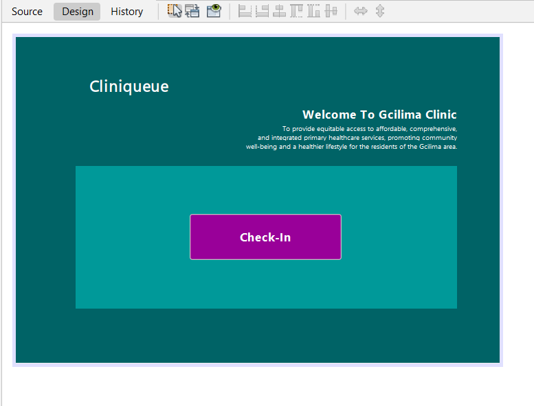
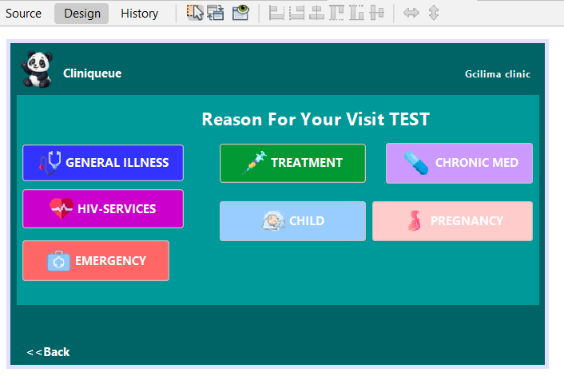
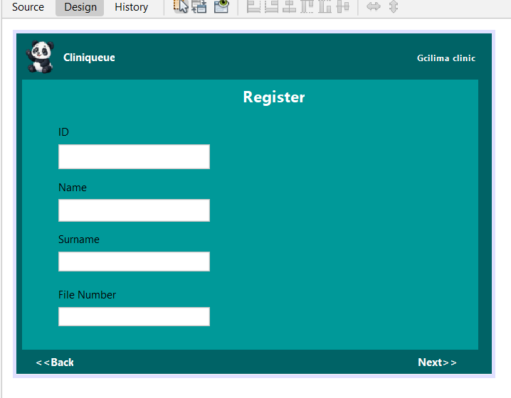
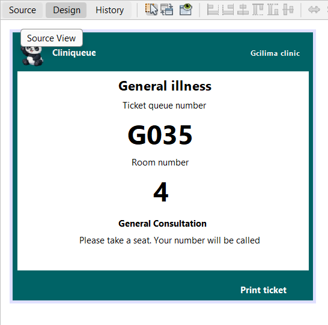

# CliniQueue

An offline queue system for rural clinics.

## Demo
Demo video coming soon.

## The problem
Many rural clinics have long, unstructured queues and no reliable
internet. Patients don't know when they will be seen.

## What it does
Patients check in at a kiosk, choose their reason for visiting,
register, and get a ticket with a queue number and room number.

## Screenshots

## Design decisions
- Works offline, so no internet is needed
- Colour-coded buttons with icons for low-literacy users
- Input validation (13-digit ID, required fields)

## Built with
Java, Swing, NetBeans, Maven

## Future improvements
- Save patients to a local SQLite database
- Staff screen to call the next patient
- isiZulu language option
- Ticket printing
